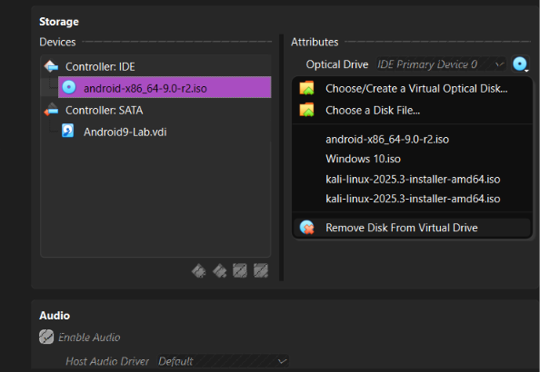

# 🔐 Cybersecurity Lab Environment Setup

**Building an isolated virtual lab for penetration testing and ethical hacking practice**

  
  
  
  
  
  
  
  
  
  
  
  

# | CYBERSECURITY & NETWORK INTERN AT NETWORKWALKS

Excited to be learning and contributing as part of the NetworkWalks internship program. Focused on building secure virtual environments, network automation, and hands-on penetration testing labs.

---

## 🔐 Cybersecurity & Lab Setup Overview

As part of my internship track at **NetworkWalks**, this project focuses on building an isolated, controlled virtual lab environment for penetration testing, ethical hacking practice, and network security analysis.

### 📌 Project Objectives
* Install and configure hypervisor technologies (**VirtualBox**).
* Deploy and configure **Kali Linux** as a security workstation.
* Create private **NAT Networks** to allow multi-machine communication.
* Configure static IP addressing, subnets, gateways, and DNS settings.
* Establish clean VM snapshots for reliable baseline recovery.

---

## 🛡️ Lab Setup Procedure

1. **Hypervisor Setup:** Installed VirtualBox to host virtual lab machines.
2. **Virtual Network Configuration:** Created a dedicated NAT Network (`NatNetwork`) with a `10.0.0.0/24` IPv4 prefix, enabling internal VM-to-VM communication alongside external internet access.
3. **Kali Linux Deployment:** Imported the Kali VM, assigned proper RAM resources, and connected its network adapter to the custom NAT Network.
4. **Static IP Configuration:** Configured a consistent static IPv4 address (e.g., `10.0.0.2`) for reliable tracking and documentation across future lab exercises.
5. **Baseline Snapshot:** Created a clean VM snapshot (`Clean Kali - Network Setup`) to ensure quick recovery before engaging in high-risk security testing.

---

## 💡 Key Learnings & Takeaways

* **NAT vs. NAT Network:** Gained deep insight into how standard NAT differs from a virtual NAT Network, which is crucial for enabling multi-node attacker/target lab topologies.
* **Virtual Networking:** Mastered how virtual adapters bridge host machines and isolated guest networks.
* **Documentation & Reproducibility:** Learned the importance of structured documentation, tracking configuration steps, and maintaining reliable recovery checkpoints.

---

## ⚠️ Disclaimer
*This repository and its contents are strictly for educational purposes and authorized security testing within isolated laboratory environments. Do not use these setups or tools against unauthorized systems.*

---

### 🌐 Connect With Me
* **Program:** NetworkWalks Cybersecurity Internship
  

